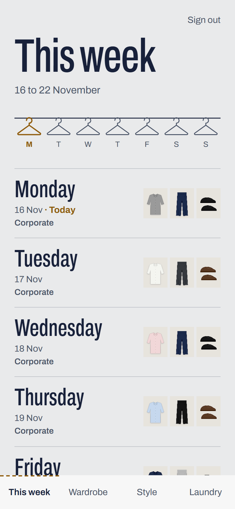
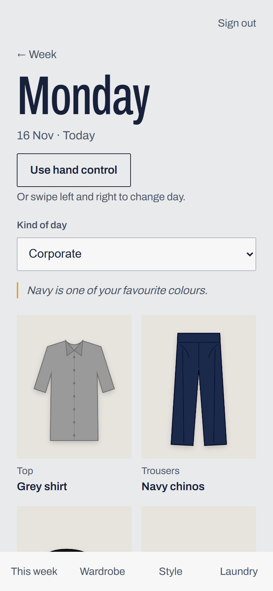
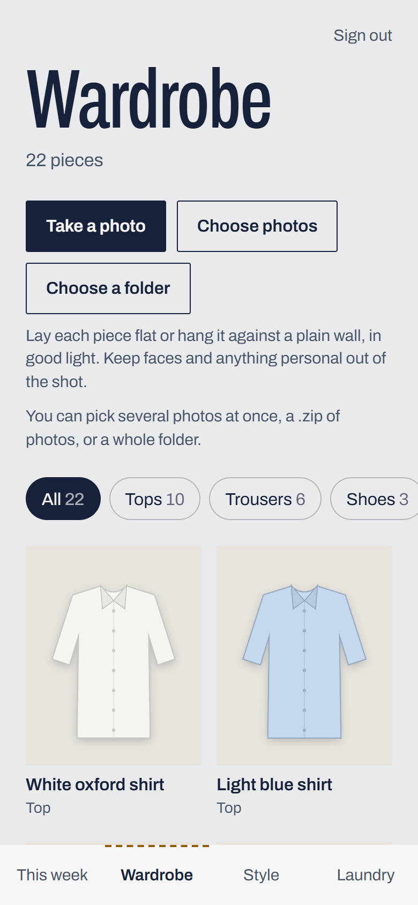
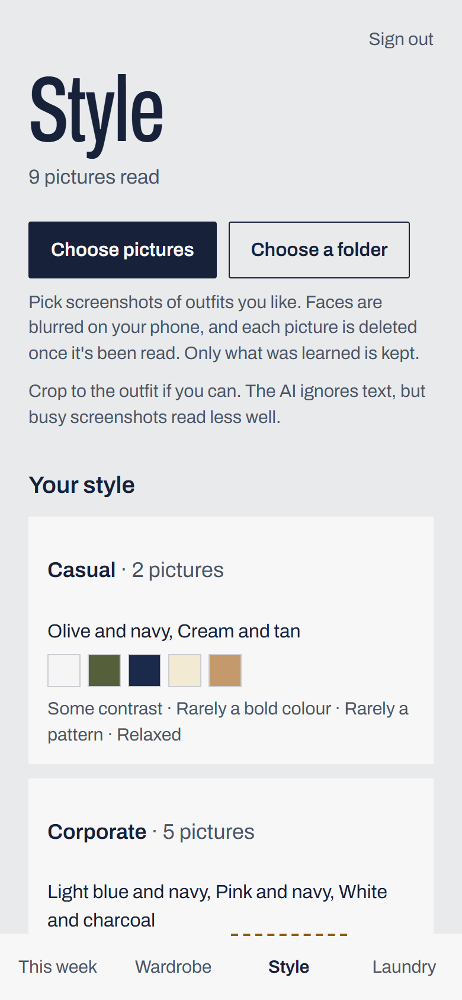
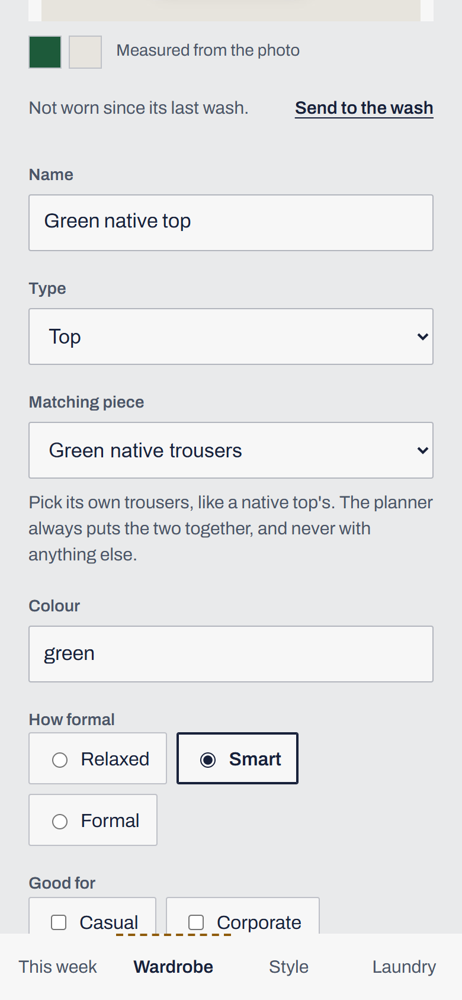

# Wardrobe planner

A personal web app that plans a Monday-to-Sunday of outfits from photos of your own clothes. It knows what's clean, learns your style from outfits you like, keeps sets together, and you can flick through outfits with a wave of your hand.

It's built for one person and a phone first, and also works on a laptop.

<p>
  
  
  
  
</p>

<sub>Screenshots use invented demo clothes.</sub>

## What it does

- **Wardrobe:** photograph your clothes one at a time, or add a batch, a `.zip` or a whole folder. On the phone, faces are blurred and location details dropped before anything is uploaded. An AI model names each piece and labels its type, colour, formality, the occasions it suits and whether it's patterned. You check the labels and fix anything wrong.
- **Planner:** it plans the week from your usual week (for example, corporate on weekdays, casual on Saturday, church on Sunday). The rules are plain code, not AI:
  - only clean pieces with wears left
  - no piece on two days in a row
  - one bold colour and one pattern at most
  - a top that stands out from the trousers
  - a belt that matches the shoes
  - no repeat of a recent top-and-trousers pair if it can be avoided

  You can change any day, swap a single piece, or ask for another outfit and go back again.
- **Weekly check:** from Sunday evening, it asks what you actually wore and what's been washed, then plans the next week. Pieces that have used up their wears go to the laundry until you mark them clean.
- **Your style:** add screenshots of outfits you like. The AI reads which colours and kinds of pieces each one uses, and the picture is deleted straight after. The planner then leans towards your favourite colours and pairings, and says why ("Navy is one of your favourite colours.").
- **Matching sets:** match a top with its own trousers, such as a native top and its trousers. The planner always puts them together and never mixes either half with anything else.
- **Hand control:** turn on the front camera and show your open palm. Swipe left or right to change day, up for another outfit, down to go back, and hold a thumbs up to mark today worn. The camera picture is read on the phone and never saved or sent. Finger swipes on the screen work too.



## Privacy

Everything private stays private, even with the code public:

- **Your data is yours only:** every table has row-level security, so a signed-in user only reaches their own rows. Sign-ups are off; the one user is added by hand.
- **Photos:** clothing photos live in a private storage bucket. Inspiration pictures are deleted once they've been read.
- **Keys:** the AI key stays in the server functions. The browser only gets Supabase's publishable key, and the build stops if a secret key is put in its place.
- **No third parties in the page:** fonts, scripts and the MediaPipe files are served from the app itself, never from a CDN or font service. The content security policy in `vercel.json` enforces this.

See [SECURITY.md](SECURITY.md) to report a problem.

## Stack

- React, TypeScript and Vite, as an installable web app
- Supabase for sign-in, the database and photo storage
- Groq for the AI labelling and inspiration reading, called from Vercel functions so the key never reaches the browser
- MediaPipe on the device: face detection for blurring, and gesture recognition for hand control
- Vercel for hosting
- Vitest and Testing Library for tests, with PGlite to check the database's security rules

## Run it locally

You need Node 22 or newer.

```bash
npm install
```

```bash
cp .env.example .env.local
```

Fill in the values in `.env.local`, then start the app:

```bash
npm run dev
```

Without the Supabase values, the app shows a screen explaining what's missing. Without the Groq key, photos are saved and wait to be read, and can be filled in by hand.

## Set up Supabase

1. Create a project at [supabase.com](https://supabase.com).
2. Under **Authentication > Sign In / Providers**, turn off **Allow new users to sign up**.
3. Under **Authentication > Users**, add your user with **Auto Confirm User** ticked.
4. Open the **SQL Editor** and run each file in `supabase/migrations`, in order:
   1. `0001_wardrobe.sql`: the wardrobe table, the private photo bucket and the rules that keep both private.
   2. `0002_planner.sql`: your usual week, planned outfits and laundry.
   3. `0003_style.sql`: inspiration readings and style settings.
   4. `0004_matching_sets.sql`: matching a top with its own trousers.
5. Copy the project URL and the publishable key into `.env.local`, and into Vercel's environment variables.

Only ever use the publishable key or the legacy anon key there. These values ship to the browser.

## Set up Groq

Groq requires account holders to be 18 or older.

1. Create an API key in the [Groq console](https://console.groq.com/keys).
2. In the console's data controls, turn on Zero Data Retention.
3. Add the key to Vercel as `GROQ_API_KEY`, marked sensitive. It has no `VITE_` prefix, so it stays on the server.
4. Optionally, set `GROQ_MODEL` to another Groq model that reads images. The default is `qwen/qwen3.8-27b`.

## Commands

| Command | What it does |
| --- | --- |
| `npm run dev` | Starts the app locally |
| `npm test` | Runs the tests, including the database security rules |
| `npm run build` | Checks types and builds for production |

The tests and a production build also run on GitHub for every push and pull request.

## Project layout

| Folder | What's in it |
| --- | --- |
| `src/screens` | One file per screen: week, day, weekly check, wardrobe, style, laundry |
| `src/lib` | The planner, colour rules, style learning, gestures, and talking to Supabase |
| `server`, `api` | The Vercel functions that call Groq |
| `supabase` | The database migrations and their security tests |
| `public/models` | The on-device MediaPipe models |

## Credits

- Set in [Archivo](https://github.com/Omnibus-Type/Archivo) by Omnibus-Type, used under the SIL Open Font License. See `src/assets/fonts/OFL.txt`.
- Face detection and hand gestures by [MediaPipe](https://github.com/google-ai-edge/mediapipe), with its BlazeFace and gesture recognizer models, under the Apache License 2.0.

## Licence

[MIT](LICENSE).
